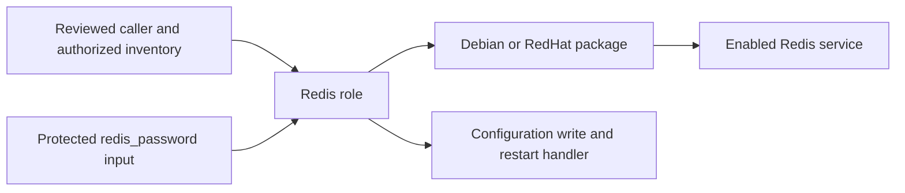

# Ansible Redis Role Reference

Reviewed 30 October 2026. This Markdown entry point complements the retained [original project notes](README) and [role documentation](redis/README.md).

## Implemented Scope

The Redis role installs the OS-specific package, enables its service and writes `requirepass` from `redis_password`. The root `playbook.yml` is empty: a reviewed caller and authorized inventory must be supplied. The file named `vars/vault.yml` is not proof of encrypted or populated secret storage.

## Review Before Running

- Inspect [tasks](redis/tasks/main.yml), [handlers](redis/handlers/main.yml), defaults and the actual OS/service naming.
- The copy task replaces a configuration file. Preserve required existing options and test the handler in a disposable environment before any live host.
- Obtain private variable input through an approved secret mechanism; do not expose it through `--diff`, logs or command history.
- Validate syntax with a caller playbook, then use an authorized non-production check. No remote hosts were configured during this documentation review.

## Work Reference

This personal example demonstrates Linux configuration and role design, not production Redis administration or migration of Redis data. See the [career project map](https://github.com/ahmed-el-mahdy/Career-Advance#personal-repository-reference-map). Existing attribution and license declarations in the role files are retained.